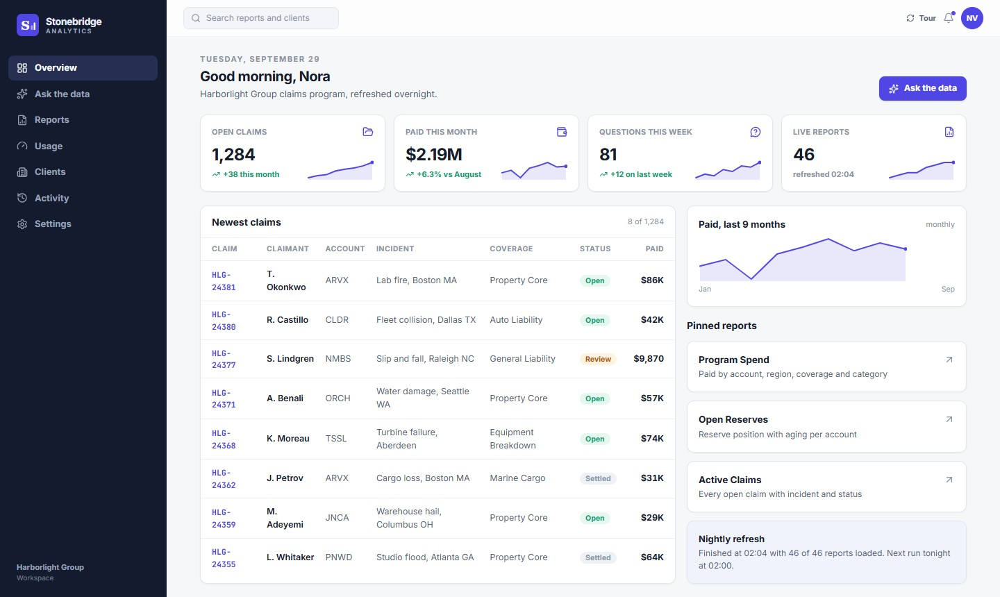
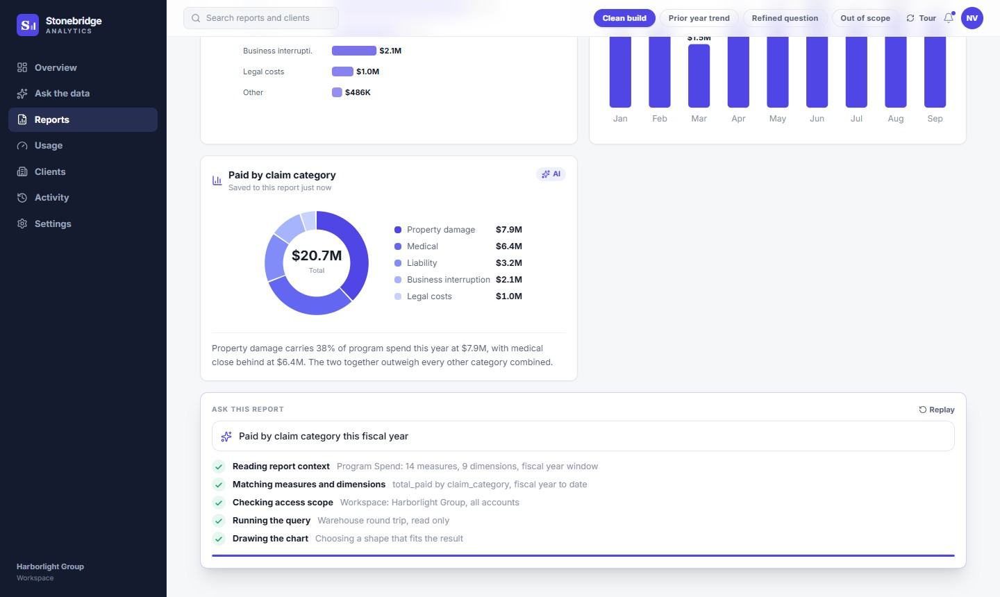
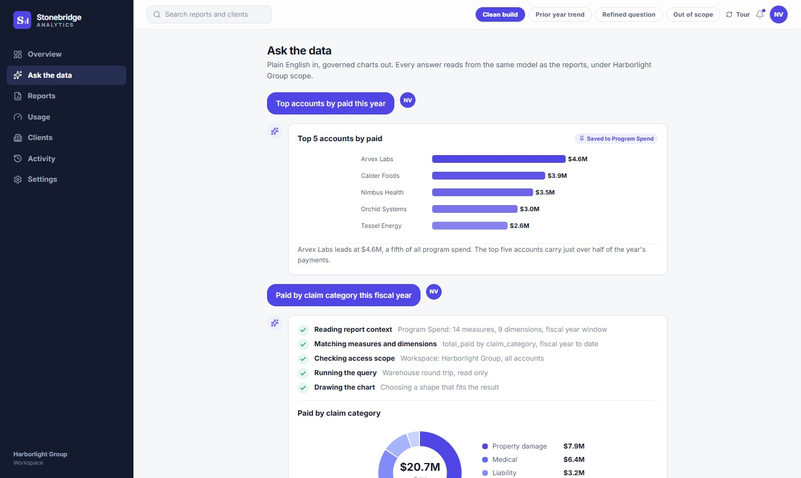
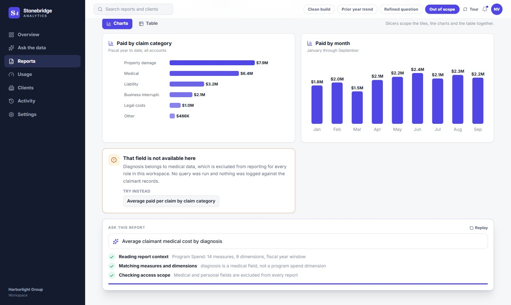
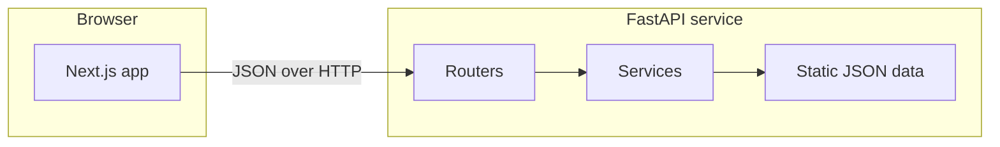

<div align="center">

# Stonebridge Analytics

**Governed claims reporting for corporate insurance programs, with a plain English question dock on every report.**


[Features](#features) ·
[Architecture](#architecture) ·
[Getting started](#getting-started) ·
[Deployment](#deployment) ·
[Backend reference](backend/README.md)

<br />



</div>

## About

Stonebridge shows how a risk or finance team can move from *"what did we spend on claims?"* to a trustworthy, auditable chart without writing a query. Every answer is built from approved report fields, every step of the pipeline is visible, and a question that touches a protected field is refused with an explanation instead of a guess.

It is two independent apps that meet only over HTTP: a **Next.js frontend** that draws the screens, and a **FastAPI backend** that serves all of the data. The frontend holds none of its own.

> All people, accounts, places, claims and figures are fictional.

## Features

- **Overview**: KPI tiles with trend lines, the newest claims, monthly paid trend and pinned reports
- **Report catalog and Program Spend**: ten reports across Finance, Operations and Partners; Program Spend adds charts by category and month, and a table view with a column chooser and pagination
- **Ask the data**: a conversation screen, and a dock on every report, where a question becomes a governed chart with a visible pipeline: read context, match measures, check access scope, run the query, draw the chart
- **Governed by design**: questions that touch medical or personal identity fields are refused by a server-side access check before anything runs
- **Administration screens**: usage analytics, clients, activity and settings
- **Guided tour** offered once per session, and **reduced motion support**
- **Dependency free charts** drawn as inline SVG

Four questions play end to end. Pick one with the pills on a report, or deep link with `?s=` on any screen:

| `?s=` | What happens |
| --- | --- |
| `grouped` | A clear question becomes a chart in one pass |
| `trend` | A prior year comparison, drawn as two series |
| `refined` | A vague question is rewritten with a concrete limit |
| `guarded` | The access check refuses a protected field and suggests an alternative |

<p align="center">
  
  
  
</p>

## Architecture



- **The backend is the only source of data.** `src/lib/api.ts` has one typed method per endpoint, and `src/lib/types.ts` mirrors the backend schemas.
- **Every route is a prerendered shell.** Data loads in the browser, so building the frontend does not need the backend.
- **Loading is handled once.** The persona and scripted questions load at startup; each screen loads its own data, with a loading state and a retry if the backend is unreachable. Repeat requests are served from an in-memory cache.
- **The backend is layered** (routers, services, data store) and validates its data at startup. Details are in the [backend reference](backend/README.md).

## Tech stack

- **Frontend:** [Next.js](https://nextjs.org/) 16 (App Router), [React](https://react.dev/) 19, [TypeScript](https://www.typescriptlang.org/) 5, [Tailwind CSS](https://tailwindcss.com/) 4, [Lucide](https://lucide.dev/) icons
- **Backend:** [FastAPI](https://fastapi.tiangolo.com/), [Pydantic](https://docs.pydantic.dev/) v2, [Uvicorn](https://www.uvicorn.org/), Python 3.12, pytest
- **Packaging:** a Docker image for the backend

## Project structure

```text
.
├── src/                  Next.js frontend
│   ├── app/              Routes: login, home, ask, reports, analytics, clients, activity, settings
│   ├── components/       App shell, charts, guided tour, views/
│   ├── hooks/            useAsync (data loading), useScriptedTimeline (animation)
│   └── lib/              api.ts (typed client), types.ts, format.ts, tour.ts
├── backend/              FastAPI service, with its own README
├── deck/                 Case study deck, screenshots and build scripts
├── tools/check.sh        Repository quality gates
└── .env.example          Frontend environment template
```

## Getting started

**Prerequisites:** Node.js 20.9 or newer (the Next.js 16 minimum) and Python 3.12 or newer. The first frontend build downloads two Google Fonts through `next/font`, so it needs internet access.

**1. Start the backend**

```bash
git clone <repository-url>
cd stonebridge-analytics/backend
python3 -m venv .venv && source .venv/bin/activate
pip install -r requirements-dev.txt
uvicorn app.main:create_app --factory --reload --port 8000
```

**2. Start the frontend** in a second terminal, from the repository root:

```bash
cp .env.example .env.local
npm install
npm run dev
```

Open <http://localhost:3000> and choose **Continue with Harborlight Group SSO**. If the backend is not running, the app says *"Can't reach the Stonebridge API"* and offers **Try again**.

## Configuration

The frontend has one setting, in `.env.local`:

| Variable | Default | Purpose |
| --- | --- | --- |
| `NEXT_PUBLIC_API_BASE_URL` | `http://localhost:8000` | Where the browser reaches the backend |

Next.js inlines this value at **build time**, so rebuild the frontend after changing it. The backend's own settings, including the `CORS_ORIGINS` that must list the frontend's address, are in the [backend reference](backend/README.md#configuration).

## Development

```bash
npm run dev          # frontend dev server
npm run build        # production build; every route must stay static
npm run check        # repository gates: naming blocklist, banned words, dash rules
cd backend && python -m pytest    # backend tests (virtualenv active)
```

Run all three checks before committing. No CI is configured.

## Deployment

Deploy the backend first, so you know the address to give the frontend.

1. **Backend:** build and run the container from `backend/`. See [Deployment](backend/README.md#deployment) for commands and settings.
2. **Frontend:** set `NEXT_PUBLIC_API_BASE_URL` to the backend's address, then `npm run build` and `npm run start`. Any platform that supports Next.js, such as Vercel, works with the same variable set in its project settings.

## Project status

This is a working product front end with a real API behind it. Some parts are deliberately simple:

- **Ask answers are scripted.** There is no language model or query engine. The four questions are stored scripts that a timeline plays back; the keyword-based access check is the only live logic in the flow.
- **The data is static and fictional.** There is no database, and the service never writes.
- **Sign in is presentational.** The SSO button enters as the sample analyst. There are no accounts or sessions.
- **Interface state is local to the browser session**, for example saving a chart or toggling a notification.

## Case study deck

[`deck/`](deck/) holds the finished case study (`.pptx` and `.pdf`), the screenshots used here, and the scripts that built them. Rebuilding is optional. `capture.js` needs both apps running, with the frontend on port 3100, and a local Chrome (edit `executablePath` for your platform). `deck-stonebridge.js` loads a theme helper from the path in its `SKILL` constant, so edit that path for your machine.

## License

All rights reserved. No open-source license has been granted.
